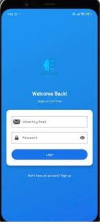
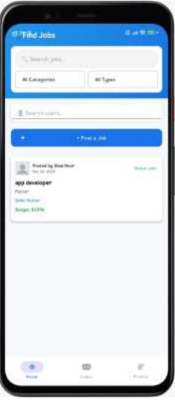
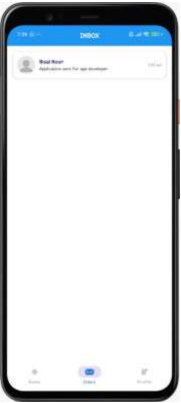
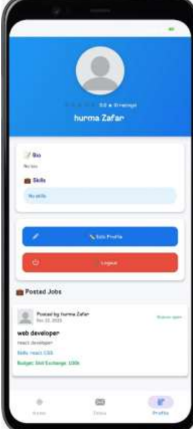

# EduEarn

An Android application built with Kotlin that connects users with job opportunities, with built-in messaging, a personal dashboard, and admin management.


## Table of Contents

- [Features](#features)
- [Screenshots](#screenshots)
- [Tech Stack](#tech-stack)
- [Project Structure](#project-structure)
- [Getting Started](#getting-started)
- [Firebase Setup](#firebase-setup)
- [App Flow](#app-flow)
- [Future Improvements](#future-improvements)
- [Author](#author)

---

## Features

- **Authentication**: Sign up and log in with `SignupActivity` and `LoginActivity`
- **Dashboard**: Browse available jobs/opportunities in a card-based list
- **Quick View**: Open a detailed view of any selected job
- **Inbox**: View all conversations in one place
- **Chat**: One-to-one messaging with left/right message bubbles
- **Profile**: View and manage your own account details
- **Admin Panel**: Dedicated `AdminActivity` for managing the platform
- **Bottom Navigation**: Quick switching between Dashboard, Inbox, Chat and Profile
- **Custom UI**: Rounded input fields and onboarding visuals

## Screenshots


| Login | Dashboard | Chat | Profile |
|-------|-----------|------|---------|
|  |  |  |  |

## Tech Stack

| Category | Technology |
|----------|------------|
| Language | Kotlin |
| IDE | Android Studio |
| UI | XML layouts, Fragments, RecyclerView, BottomNavigationView |
| Architecture | Activity + Fragment with Adapter/Model separation |
| Authentication | Firebase Authentication (Email/Password) |
| Database | Cloud Firestore |
| Storage | Firebase Storage|
| Build System | Gradle |

## Project Structure

```
app/src/main/
├── java/com/example/owner/eduearn/
│   ├── adapters/
│   │   ├── ChatAdapter.kt
│   │   ├── DashboardAdapter.kt
│   │   ├── InboxAdapter.kt
│   │   └── JobAdapter.kt
│   ├── models/
│   │   ├── ChatPreview.kt
│   │   ├── job.kt
│   │   └── Message.kt
│   ├── AdminActivity.kt
│   ├── ChatFragment.kt
│   ├── DashboardFragment.kt
│   ├── InboxFragment.kt
│   ├── LoginActivity.kt
│   ├── MainActivity.kt
│   ├── ProfileFragment.kt
│   ├── QuickView.kt
│   └── SignupActivity.kt
└── res/
    ├── layout/
    │   ├── activity_admin.xml
    │   ├── activity_login.xml
    │   ├── activity_main.xml
    │   ├── activity_quick_view.xml
    │   ├── activity_signup.xml
    │   ├── fragment_chat.xml
    │   ├── fragment_dashboard.xml
    │   ├── fragment_inbox.xml
    │   ├── fragment_profile.xml
    │   ├── item_dashboard.xml
    │   ├── item_inbox.xml
    │   ├── item_job.xml
    │   ├── item_message.xml
    │   ├── item_message_left.xml
    │   └── item_message_right.xml
    ├── menu/
    │   └── bottom_nav_menu.xml
    ├── drawable/   (rounded_edittext.xml, rounded_field.xml, onboard2.jpg)
    └── mipmap/     (launcher icons)
```

## Getting Started

### Prerequisites

- [Android Studio](https://developer.android.com/studio) (latest stable version)
- JDK 17 or higher
- An Android device or emulator (API level TODO+)

### Installation

1. **Clone the repository**
   ```bash
   git clone https://github.com/<your-username>/EduEarn.git
   ```
2. **Open the project** in Android Studio (`File > Open` and select the project folder).
3. **Sync Gradle** and wait for dependencies to download.
4. **Set up Firebase** (see [Firebase Setup](#firebase-setup) below). The app will not run without it.
5. **Run the app** on an emulator or physical device using the green ▶ button.

## Firebase Setup

EduEarn uses Firebase as its backend. The `google-services.json` file is **not included** in this repository, so you need to connect your own Firebase project.

1. Go to the [Firebase Console](https://console.firebase.google.com/) and click **Add project**.
2. Click the Android icon to **add an Android app** and enter the package name:
   ```
   com.example.owner.eduearn
   ```
3. (Optional) Add your **SHA-1 fingerprint**, required for Google Sign-In:
   ```bash
   ./gradlew signingReport
   ```
4. Download **`google-services.json`** and place it in the `app/` folder:
   ```
   EduEarn/
   └── app/
       └── google-services.json
   ```
5. Enable the services the app uses:
   - **Authentication** → Sign-in method → enable **Email/Password**
   - **Firestore Database** → Create database
   - **Storage** (TODO: only if used)
6. Make sure the Firebase dependencies are in your Gradle files (they should already be in the project):
   ```kotlin
   // build.gradle.kts (project level)
   plugins {
       id("com.google.gms.google-services") version "4.4.2" apply false
   }

   // build.gradle.kts (app level)
   plugins {
       id("com.google.gms.google-services")
   }
   dependencies {
       implementation(platform("com.google.firebase:firebase-bom:33.1.2"))
       implementation("com.google.firebase:firebase-auth")
       implementation("com.google.firebase:firebase-firestore")
   }
   ```
7. Set your **Firestore Security Rules** so only signed-in users can read and write. Do not leave the database in test mode:
   ```
   rules_version = '2';
   service cloud.firestore {
     match /databases/{database}/documents {
       match /{document=**} {
         allow read, write: if request.auth != null;
       }
     }
   }
   ```
   Tighten these further (per-user and admin-only rules) before publishing the app.

> **Security note:** Never commit `google-services.json` or any Firebase Admin SDK key to a public repository.

## App Flow

```
Launch → Signup / Login → MainActivity (Bottom Navigation)
                              ├── Dashboard → Quick View (job details)
                              ├── Inbox → Chat
                              ├── Chat
                              └── Profile

Admin users → AdminActivity
```

## Future Improvements

- Push notifications for new messages and jobs
- Search and filter options on the dashboard
- Image and file sharing in chat
- Dark mode support

## Author

**Arooba**

